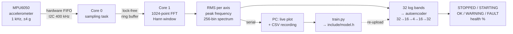

# Machine Health Monitor

**Predictive maintenance on a $5 microcontroller.** An ESP32 listens to a machine's vibration through an MPU6050 accelerometer, computes its frequency spectrum in real time, and runs a small neural network, trained only on healthy running, that raises a warning when the machine starts behaving abnormally. All of it runs on the board itself.


> **Current state: stage 2 of 4.** Vibration analysis and anomaly detection run on the ESP32. Next comes a display on a CYD touchscreen board, then MQTT telemetry.

## Highlights

- **1 kHz vibration sampling** with the sensor's hardware FIFO, so sample timing is exact no matter what the CPU is doing.
- **Dual-core design**: a FreeRTOS task on core 0 collects samples into a lock-free ring buffer while core 1 does the signal processing and inference.
- **Real-time FFT** of 1,024 points with a Hann window and 50% overlap, giving a new spectrum every 0.5 s at 0.98 Hz resolution.
- **Unsupervised anomaly detection** using an autoencoder with 1,220 parameters, trained only on healthy data, so no failure examples are needed.
- **It explains its alarms**: the firmware reports which frequency band changed the most.
- **Honest evaluation**: alarm levels and false-alarm rates are measured on data held out from training, with blocked cross-validation.
- **Self-healing firmware** that recovers from lost samples, loose wires and sensor resets without a reboot.
- **Full tool chain**: live spectrum viewer, data recorder, training script and a C header exporter, plus one-click Windows scripts.

## Roadmap

| Stage | What it adds | Status |
| --- | --- | --- |
| 1 | 1 kHz sampling, on-device FFT, live spectrum on the PC, data recording | ✅ done |
| 2 | Anomaly detection trained on healthy data only, running on the ESP32 | ✅ done |
| 3 | Live dashboard on a 2.8" TFT (ESP32 CYD board): spectrum, health score, status | 🔜 next |
| 4 | MQTT telemetry and a PC dashboard with alerts | planned |

## How it works



### 1. Signal processing

| Step | Detail |
| --- | --- |
| Sampling | MPU6050 at 1 kHz, ±4 g, 184 Hz low-pass filter, gyro switched off |
| Transfer | Hardware FIFO read in bursts over 400 kHz I²C every 10 ms |
| Window | 1,024 samples (1.02 s), Hann window, 50% overlap |
| FFT | Radix-2 FFT on each axis, written from scratch |
| Output | RMS per axis, dominant frequency (with parabolic interpolation between bins), and a 256-bin amplitude spectrum from 0 to 500 Hz in milli-g |

### 2. Anomaly detection

Real machines rarely provide examples of failures, so the detector only learns what **healthy** running looks like and flags anything that departs from it.

1. **Features.** Each spectrum is reduced to 32 frequency bands of log amplitude, then standardized.
2. **Autoencoder.** A 32 → 16 → 4 → 16 → 32 network learns to rebuild healthy band patterns through a 4-number bottleneck. Anything it has never seen, it rebuilds poorly.
3. **Score.** The score is the reconstruction error of the *worst* band divided by the alarm threshold. A change in one place, such as the shaft-speed peak growing, is not diluted by the 31 unchanged bands. The worst band also shows *where* the change is.
4. **Decision logic.** Scores are smoothed with an exponential moving average.
   - **WARNING** above 1.0 and **FAULT** above 2.0, each held for 1.5 s.
   - Back to **OK** after 3 s below 0.8, so the state does not flicker.
   - **STOPPED** when the overall vibration falls below the level learned for a switched-off machine.
   - **STARTING** holds alarms back for 5 s after power-on or start-up.
5. **Health %.** Health is 100% for normal running and 50% at the warning level.

### 3. Training and validation (`tools/train.py`)

- Healthy recordings are split into sessions. The first and last seconds of each session are dropped, because that is when the machine is touched to start and stop the recording. Bumps are dropped too.
- **The threshold comes from 5-fold blocked cross-validation**: the model is trained on 4/5 of the data and scored on 20-second blocks it has never seen. The threshold is the sustained level of those held-out scores plus a 25% margin. Random splits would leak neighbouring, nearly identical spectra into training and give an optimistic result.
- Faults are **simulated** on held-out healthy data (imbalance, looseness, a bearing tone, rubbing) to measure how often each one is detected.
- The model is exported as a C header. A self-check confirms that the exported weights reproduce the Python results.

## Results

### Primary machine: PC case fan

The model was trained on a rear PC case fan running at about **3,220 rpm (53.7 Hz)**: 6 recording sessions, of which **569 spectra in 5 sessions** remained after cleaning.

| Test (on held-out data) | Result |
| --- | --- |
| Healthy running never seen in training (4.7 min) | **0 false warnings** |
| Imbalance: shaft-speed peak ×1.5 | warning 89% of the time |
| Imbalance: ×2 and ×3 | detected 98% of the time (FAULT) |
| Looseness: shaft harmonics appear | detected 98% of the time |
| New bearing tone at 287 Hz | detected 98% of the time |
| Rubbing: the noise floor rises | detected 98% of the time |


*Held-out healthy sessions (green) stay under the warning line. Every simulated fault rises above it, most of them far above (log scale).*

### Second machine: desk fan

The same pipeline was also trained on a desk fan (1,465 rpm, 3 blades) to check that it is not tuned to one machine:

| Test | Result |
| --- | --- |
| Healthy data never seen in training (3.5 min) | 0 false warnings |
| Imbalance ×3 / looseness / rubbing | detected 95% / 98% / 98% of the time |
| Imbalance ×2 / new bearing tone | 19% / 32% (subtle changes; more healthy data sharpens this) |
| Fan switched off | correctly reported as STOPPED |

### Firmware vs. Python

The C++ detector was compared with the Python model on every recorded spectrum. The largest difference in score was **0.000005**.

> **One model per machine.** Every machine has its own vibration signature, so each one needs its own healthy recording and training run. A model trained on the desk fan flags the case fan as FAULT, which is correct: it really is different.

## Hardware

| Part | Notes |
| --- | --- |
| ESP32 DevKit (30-pin) | PlatformIO board `esp32dev` |
| GY-521 (MPU6050) | 3-axis accelerometer |
| A machine to monitor | PC fan, desk fan or small DC motor |

### Wiring

| GY-521 | ESP32 |
| --- | --- |
| VCC | 3V3 |
| GND | GND |
| SCL | GPIO 22 |
| SDA | GPIO 21 |

The onboard LED (GPIO 2) shows the state: it blinks while running normally, stays on for FAULT, and is off when the machine is STOPPED.

### Mounting

**Mounting matters more than anything else.** Fix the GY-521 rigidly to the **non-rotating housing** of the machine, as close to the motor or bearing as you can: a screw through its mounting hole, a zip tie, or hot glue. Never mount it on a moving part. Foam tape and loose wires absorb exactly the vibration you want to measure, and wires that move with the machine eventually lose contact. Power the machine from its own supply, never from an ESP32 pin.

## Getting started

**Requirements:** VS Code with the PlatformIO extension, and Python 3. The Windows scripts use the Python that comes with PlatformIO, so nothing else needs to be installed.

### Windows (no terminal)

1. Double-click **`setup.bat`** once. It creates a Python environment with the required packages.
2. In VS Code, click **Upload** (→).
3. Close the serial monitor, then double-click **`view.bat`**. The live spectrum opens in your web browser. Press Ctrl+C in the console window to stop.
4. **Record healthy running:** double-click **`record.bat`**, name the recording `healthy` and let the machine run for about 2 minutes without touching it. Repeat a few times (answer `a` to add to the file), ideally restarting the machine in between.
5. Double-click **`train.bat`**. It prints the false-alarm and fault-detection results, saves `docs/anomaly_scores.png` and writes `include/model.h`.
6. Click **Upload** again. At boot the board prints `# Model: …` with the date it was trained, which confirms the new model is on it.

### Command line

```bash
pip install -r tools/requirements.txt
pio run -t upload                                     # firmware
python tools/live_view.py                             # live spectrum
python tools/live_view.py --record healthy --seconds 120
python tools/train.py                                 # train, evaluate, export include/model.h
pio run -t upload                                     # upload with the new model
```

`live_view.py` options: `--port COM5` picks the port, and `--no-plot` gives text output only. Without `--port`, it finds the ESP32 by its USB chip.

## Serial output

The PlatformIO serial monitor (115200 baud) shows one line per spectrum:

```
t=<seconds>  <STATE>  health <%>  score <smoothed> | vib <mg> peak <Hz> (<rpm>) | dsp <ms> | biggest change <Hz range>
```

- `vib` is the total vibration (RMS of all axes) in milli-g.
- `peak` is the dominant frequency. Multiply it by 60 to get rpm.
- `dsp` is the time the ESP32 spent on the FFT and analysis for that spectrum.
- `biggest change` appears only in WARNING and FAULT.

Lines starting with `#` are messages: start-up, the model summary, state changes and sensor problems.

Sending `s` turns on machine-readable streaming (used by `live_view.py`), and `q` turns it off:

```
H,<state>,<score>,<smoothed>,<health %>,<band low Hz>,<band high Hz>
S,<t>,<rms x>,<rms y>,<rms z>,<peak Hz>,<peak mg>,<256 bins in mg>
```

## Recorded data

Recordings are saved as `data/<label>.csv`, one row per spectrum (every 0.5 s):

`t, rms_x, rms_y, rms_z, peak_hz, peak_mg, b0 … b255`

RMS values are in g, and the bins are in milli-g. Bin *i* covers *i* × 1.95 Hz to (*i* + 1) × 1.95 Hz.

- `data/healthy*.csv` files are used for training.
- Any other CSV is used only for testing: `train.py` reports what the detector says about it.
- Recordings of another machine can be kept in a subfolder, such as `data/desk_fan/`.

## Reading a vibration spectrum

- The **tallest peak** is usually the shaft speed: peak Hz × 60 = rpm.
- **Multiples** of it (2×, 3×) are normal harmonics. A fan also shows a peak at shaft speed × number of blades.
- **Imbalance** (try taping a coin to one blade) makes the shaft-speed peak grow.
- **Looseness** adds many harmonics and raises the noise floor.
- **Bearing wear** shows up as new tones that are not multiples of the shaft speed.

## Configuration

| File | Contents |
| --- | --- |
| `include/config.h` | Pins, I²C address and speed, sample rate, FFT size, overlap, lowest peak frequency |
| `include/model.h` | The trained detector, generated by `train.py`; do not edit by hand |
| `src/anomaly.cpp` | Smoothing, alarm levels and timings |

## Project structure

```
machine-health-monitor/
├── src/
│   ├── main.cpp          setup, core 0 sampling task, reporting, serial commands, LED
│   ├── mpu_fifo.cpp/.h   MPU6050 driver: 1 kHz accelerometer through the FIFO
│   ├── sampler.cpp/.h    keeps the FIFO drained; detects and recovers from faults
│   ├── sample_ring.h     lock-free single-producer, single-consumer ring buffer
│   ├── fft.cpp/.h        radix-2 FFT
│   ├── analysis.cpp/.h   windowing, RMS, spectrum, peak detection (Analyzer class)
│   └── anomaly.cpp/.h    band features, autoencoder, smoothing, machine state (Detector class)
├── include/
│   ├── config.h          settings
│   └── model.h           trained detector (generated)
├── tools/
│   ├── live_view.py      live plot and CSV recording
│   ├── train.py          trains, evaluates and exports the detector
│   └── requirements.txt
├── data/                 recordings
├── docs/                 result plots
├── setup.bat  view.bat  record.bat  train.bat     Windows helpers
└── platformio.ini
```

## Troubleshooting

| Problem | Fix |
| --- | --- |
| `MPU6050 not found` | Check the four wires. If AD0 is connected to 3V3, set `MPU_ADDR` to `0x69` in `config.h`. |
| `Sensor stopped answering and was set up again` | A wire lost contact. Use short wires and fix them so they do not move with the machine. |
| `Warning: samples were lost` | Rare, and the analysis restarts automatically. Frequent warnings mean something is blocking the ESP32. |
| `Could not open COMx` / access denied | Close the PlatformIO serial monitor (only one program can use the port). |
| Flat spectrum, tiny RMS | The sensor is not coupled to the machine. Mount it rigidly. |
| FAULT right after training | Check the `# Model:` line at boot. If the date is old, upload the firmware again after `train.bat`. Also check that the model was trained on *this* machine. |
| `STOPPED` while the machine runs | The vibration is below the learned stop level. The sensor may have come loose; re-mount it and retrain. |
| Warnings during normal running | Normal running varies more than the recordings showed. Record more healthy sessions and run `train.bat` again. |

## Limitations

- The faults in the results are **simulated** by modifying healthy spectra. They are not physical faults, so the real-world detection rate will differ.
- The detector learns one operating condition. A machine with several speeds needs healthy recordings at each speed.
- The 184 Hz sensor filter and the 500 Hz sampling limit (half of 1 kHz) mean high-frequency bearing faults are only partly visible.
